<!-- ===================================================== -->
<!-- MUHAMMAD FAIZAN UD DIN | DEVELOPER PROFILE README -->
<!-- ===================================================== -->

  

  

   

  
  
  

    

  

---

<!-- ============ DIGITAL ID CARD ============ -->

  <h2>DEVELOPER IDENTITY</h2>

  

  
<strong>IDENTITY VERIFIED · IDEAS IN PROGRESS · BUILDING THE FUTURE</strong>

---

## About Me

I'm **Muhammad Faizan Ud Din**, a Full Stack Developer specializing in the MERN stack. I enjoy transforming ideas into practical digital products, building responsive user interfaces, developing backend functionality, and exploring AI-powered applications.

My focus is on creating modern web experiences that combine thoughtful design, reliable functionality, and clean development practices.

- **Role:** Full Stack Developer
- **Specialization:** MERN Stack Development
- **Current Projects:** HyperNova AI and Fizora Lab
- **Interests:** Web Applications, Artificial Intelligence, UI/UX, and Product Development
- **Goal:** Build useful, scalable, and user-focused digital products.

---

## Technology Stack

  

<table align="center">
  <tr>
    <td align="center" width="180"><strong>Frontend</strong></td>
    <td>
      
      
      
      
    </td>
  </tr>
  <tr>
    <td align="center"><strong>Backend</strong></td>
    <td>
      
      
      
    </td>
  </tr>
  <tr>
    <td align="center"><strong>Database</strong></td>
    <td>
      
      
    </td>
  </tr>
  <tr>
    <td align="center"><strong>Tools</strong></td>
    <td>
      
      
      
      
    </td>
  </tr>
</table>

---

## Featured Projects

<table>
  <tr>
    <td width="50%" valign="top">
      

        
        <h3>HyperNova AI</h3>
      

      An AI-focused web project designed to explore intelligent digital experiences and make AI-powered interactions more accessible.
        
      <strong>Focus Areas</strong>
       
      AI integration · Web development · User experience
        
      <a href="https://github.com/Fayzen-exe?tab=repositories">Explore Repositories</a>
    </td>
    <td width="50%" valign="top">
      

        
        <h3>Fizora Lab</h3>
      

      A web development project focused on modern interfaces, structured implementation, and practical digital solutions.
        
      <strong>Focus Areas</strong>
       
      Full-stack development · UI design · Web applications
        
      <a href="https://github.com/Fayzen-exe?tab=repositories">Explore Repositories</a>
    </td>
  </tr>
</table>

---

## GitHub Analytics

  

  

    

  

    

  

---

## Connect With Me

  

  

  

    

  <strong>Building with purpose. Developing with passion. Creating with technology.</strong>

    

  

